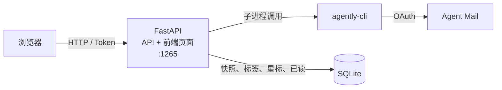

# 云邮盒 · AgentQQ Email

多微信、多邮箱聚合工作台。通过腾讯 Agent Mail 官方 `agently-cli` 连接邮箱，把不同微信授权的邮箱集中到同一个界面：统一收件、标签分组、一键已读、星标、发送、回复、删除，并在本地 SQLite 中保存邮件快照。

> 本项目并非腾讯官方产品，邮箱能力全部来自 Agent Mail 官方 CLI。

## 功能

| 功能 | 说明 |
| --- | --- |
| 多微信授权 | 每次扫码创建独立的 CLI 工作区，可同时连接多个微信；同一邮箱重新扫码会自动替换旧授权，标签和星标保留 |
| 多邮箱聚合 | 一个微信下的多个 Agent Mail 邮箱分别显示；可查看单个邮箱、全部邮箱或某个标签下的邮箱 |
| 标签分组 | 独立的「标签管理」页：新建、重命名、8 种颜色、批量分配邮箱；一个邮箱最多 8 个标签，侧边栏、邮件列表、邮件详情都会显示 |
| 一键已读 | 按当前筛选（邮箱 / 标签 / 搜索）把未读邮件全部标为已读；本地立即生效，后台同步到 Agent Mail |
| 邮件处理 | 阅读正文、星标、写信、回复、移入垃圾箱、永久删除；支持官方服务的二次确认 |
| 账号管理 | 独立的「账号管理」页：检测授权状态、重新扫码、删除邮箱（可选保留本地邮件记录） |
| 联系人 | 根据收件箱往来邮件自动整理 |
| 安全展示 HTML 邮件 | 白名单重建邮件内容，去掉脚本、隐藏预览文字、移动端/桌面端重复内容和排版表格 |
| 本地快照 | CLI 暂时不可用时显示最近一次同步的邮件 |
| 控制台登录 | Bearer Token 保护全部接口；10 分钟内失败 5 次锁定 15 分钟 |
| 界面 | 暖色纸张底、赤陶色强调、衬线标题；浅色 / 深色 / 跟随系统；适配手机 |
| 宝塔一键部署 | 一条命令完成虚拟环境、依赖、配置、CLI 安装、systemd 服务和健康检查 |

## 技术栈

| 层 | 选型 |
| --- | --- |
| 后端 | Python 3.8 – 3.13、FastAPI、Uvicorn（单进程） |
| 数据库 | SQLite（标准库 `sqlite3`，WAL 模式） |
| 前端 | Vue 3、TypeScript、Vite、Arco Design Vue |
| 邮箱能力 | 腾讯 Agent Mail 官方 `agently-cli`（Node.js） |

## 工作原理



前端不直接调用 CLI，也接触不到 OAuth 凭据。后端负责身份校验、调用 CLI 和读写 SQLite；OAuth 凭据由官方 CLI 保存在运行服务的 Linux 用户下。

## 快速开始（本地开发）

需要 Python 3.8+ 和 Node.js 20+。

```bash
# 后端
python3 -m venv .venv && .venv/bin/pip install -r requirements.txt
cp .env.example .env
.venv/bin/python run.py                      # http://127.0.0.1:1265

# 前端（另开终端，/api 自动代理到 1265）
cd frontend && npm install && npm run dev    # http://127.0.0.1:5173
```

连接真实邮箱需要先安装官方 CLI：`npm install -g @tencent-qqmail/agently-cli`，然后在页面上点「扫码添加微信」。

### 演示模式

没有 Agent Mail 账号时，可以用仓库自带的 CLI 模拟器体验完整流程（扫码几秒后自动“授权成功”，生成示例邮件）：

```bash
cd frontend && npm install && npm run build && cd ..
bash scripts/dev/demo.sh                     # 数据写在 data-demo/，不影响正式数据
```

默认账号 `admin`，默认密码 `abadmin123ab`。任何能被他人访问的环境都必须修改 `.env` 中的密码。

## 宝塔面板部署

### 1. 打包

```bash
bash scripts/build-baota.sh                  # 生成 outputs/yunyouhe-baota-v<版本>-<日期>.tar.gz
```

部署包已包含构建好的前端，服务器上不需要再构建前端。

### 2. 一键安装

服务器需要 Python 3.8+（宝塔「Python 项目管理器」或系统自带）和 Node.js 20+（宝塔「Node.js 版本管理器」）。把部署包上传到 `/www/wwwroot/` 并解压，然后在宝塔终端执行：

```bash
cd /www/wwwroot/yunyouhe && bash deploy/baota/install.sh
```

脚本会自动：

- 找到合适的 Python，并创建 `.venv` 虚拟环境；环境不完整时会自动重建。
- 安装依赖；默认源失败时自动切换到阿里云 / 清华镜像。
- 首次安装时生成 `.env`、随机登录密码和 Token 密钥，结束时打印登录密码。
- 找到宝塔安装的 Node.js，并安装 `agently-cli`。
- 停掉旧进程，注册 systemd 服务 `yunyouhe`（开机自启、异常重启），最后做健康检查。

| 参数 | 作用 |
| --- | --- |
| `--public` | 监听 `0.0.0.0`，允许 `服务器IP:1265` 直接访问（需在宝塔和云厂商安全组放行端口） |
| `--port 8080` | 修改端口 |
| `--user www` | 以其他 Linux 用户运行（默认 root） |
| `--no-service` | 只装依赖、生成配置，不启动 |
| `--config-only` | 只生成 `.env` 并安装 CLI，作为宝塔「Python 项目」的初始化命令 |

### 3. 访问

推荐绑定域名：宝塔「网站 → 添加站点」，再在站点「反向代理」中把目标 URL 设为 `http://127.0.0.1:1265`，然后开启 SSL。

如果更想在宝塔界面里启停，也可以改用宝塔「Python 项目」部署，与一键安装二选一。完整步骤和常见问题见 [宝塔部署文档](deploy/baota/README.md)。

### 4. 日常管理与升级

```bash
bash deploy/baota/yunyouhe.sh status|restart|logs
```

升级时，把新部署包解压覆盖到原目录（保留 `data/`、`.env`、`.venv/`），再执行一次 `install.sh`。新版本首次启动会自动升级表结构。

## 配置项（`.env`）

| 变量 | 默认值 | 说明 |
| --- | --- | --- |
| `HOST` / `PORT` | `127.0.0.1` / `1265` | 监听地址与端口 |
| `DASHBOARD_USERNAME` / `DASHBOARD_PASSWORD` | `admin` / `abadmin123ab` | 控制台账号 |
| `DASHBOARD_TOKEN_SECRET` | 自动生成 | 登录 Token 签名密钥（保存在 `data/dashboard-token.secret`） |
| `TOKEN_TTL_DAYS` | `30` | 登录有效期（天） |
| `AGENTLY_CLI_PATH` | `agently-cli` | CLI 路径，宝塔环境建议写绝对路径 |
| `EXTRA_PATH` | 空 | 追加到 PATH 的目录（Node.js 所在目录） |
| `AGENTLY_TIMEOUT` | `30` | CLI 单次调用超时（秒） |
| `AGENTLY_WORKSPACE` | 空 | 首次启动时导入的已有 CLI 工作区（旧版为 `codex`） |
| `DATA_DIR` | `data` | 数据目录 |
| `API_DOCS` | 空 | 设为 `1` 时开放 `/api/docs` 接口文档 |

## 数据与凭据

| 数据 | 位置 |
| --- | --- |
| 邮件快照、邮箱、标签、星标、已读记录 | `data/agent-mail.sqlite` |
| 登录 Token 签名密钥 | `data/dashboard-token.secret` |
| Agent Mail OAuth 凭据 | 官方 CLI 管理，保存在运行服务的用户下 |
| 浏览器登录状态、主题偏好 | 浏览器本地存储 |

仓库已忽略 `.env`、`data/`、`data-demo/`、日志、依赖和构建产物，不要提交数据库、Token 或密码。

## API

除 `/health` 与 `/api/login` 外，所有接口都需要 `Authorization: Bearer <token>`。

| 方法 | 路径 | 说明 |
| --- | --- | --- |
| POST | `/api/login` | 登录 |
| GET | `/api/session` | 校验登录状态 |
| GET | `/api/dashboard?folder=&account=&label=` | 同步并返回邮箱、邮件、联系人、标签 |
| GET | `/api/messages/{id}?workspace=` | 读取邮件正文 |
| POST | `/api/messages/{id}/star` | 星标 / 取消星标 |
| POST | `/api/mail/mark-read` | 一键已读 |
| POST | `/api/mail/action` | 发送、回复、移入垃圾箱、永久删除 |
| PUT | `/api/aliases/{aliasId}/labels` | 设置某个邮箱的标签 |
| GET / POST | `/api/labels` | 标签列表 / 新建标签 |
| PUT / DELETE | `/api/labels/{name}` | 重命名、改颜色、分配邮箱 / 删除标签 |
| POST | `/api/workspaces/check` | 检测授权状态 |
| POST | `/api/workspaces/remove` | 删除邮箱账号 |
| POST / GET | `/api/auth/start` · `/api/auth/status` | 扫码授权会话 |

## 目录结构

```text
run.py                  启动入口（python3 run.py）
requirements.txt        Python 依赖
backend/app/
  config.py             读取 .env 配置
  db.py                 SQLite 表结构与自动升级
  agently.py            agently-cli 封装：同步、读信、收发删、标签、已读、扫码授权
  security.py           登录 Token 与登录限流
  main.py               API 路由 + 前端静态资源
frontend/src/
  views/                登录页、主界面
  components/           侧边栏、邮件列表、详情、写信、扫码、标签管理、账号管理
  stores/               登录状态、邮箱数据、主题
  utils/mailHtml.ts     HTML 邮件白名单重建
deploy/baota/           一键安装脚本、服务管理脚本、Nginx 示例、部署文档
scripts/build-baota.sh  构建并打包宝塔部署包
scripts/dev/            本地演示用的 agently-cli 模拟器
```

## 从旧版（Node.js / Egg.js）迁移

把旧项目的 `server/data/agent-mail.sqlite` 和 `server/data/dashboard-token.secret` 复制到新项目的 `data/` 目录，然后重启。表结构兼容，旧标签会自动补上颜色。

## 已知限制

- 邮件能力取决于官方 CLI 当前提供的命令和授权状态。
- 服务必须单进程运行：扫码授权会话保存在进程内存里。
- 授权页需要在电脑上打开、用手机微信扫码；同一部手机无法识别本机屏幕上的二维码。
- 目前只有一个控制台管理员账号，不支持多用户。
