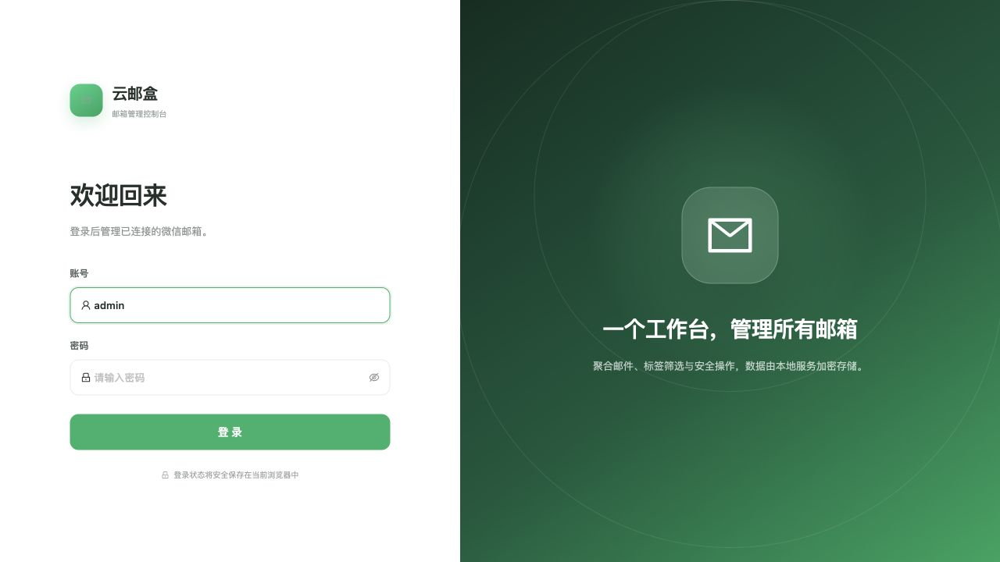
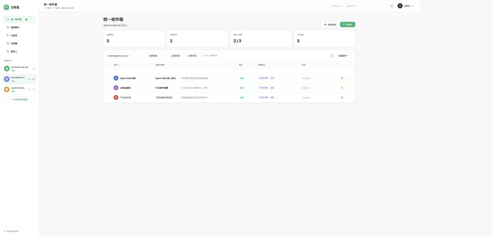
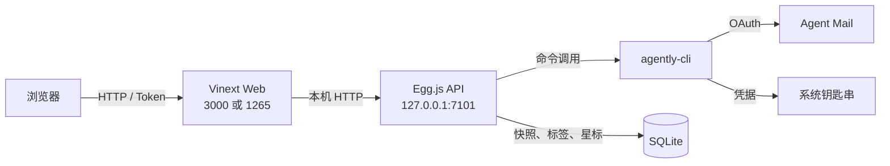

# 云邮盒（AgentQQ）

一个面向 Agent Mail 的多微信、多邮箱聚合工作台。它通过腾讯官方 `agently-cli` 连接邮箱，把不同微信账号授权的邮箱集中到同一个界面中，支持统一收件、标签筛选、星标、发送、回复、删除与本地数据快照。

> 当前仓库处于可用的早期版本，GitHub 仓库暂为私有。项目并非腾讯官方产品；邮箱操作能力来自腾讯 Agent Mail 官方 CLI。

## 界面预览

截图使用临时匿名数据生成，不包含真实邮箱、微信账号或授权凭据。





## 核心能力

| 能力 | 说明 |
| --- | --- |
| 多微信授权 | 每次扫码创建独立 CLI 工作区，可同时保留多个微信账号 |
| 多邮箱聚合 | 一个微信可关联多个 Agent Mail 邮箱，每个邮箱独立展示 |
| 邮件筛选 | 按邮箱、邮箱标签、类型、状态和关键词筛选 |
| 默认轻量加载 | 默认读取上次选择的邮箱；可以手动切换“全部邮箱”并保留选择记录 |
| 邮件处理 | 查看 Markdown 正文、星标、发送、回复、移入垃圾箱和永久删除 |
| 常用视图 | 统一收件箱、星标邮件、已发送、垃圾箱和联系人 |
| 本地快照 | CLI 暂时不可用时读取最近一次 SQLite 邮件快照 |
| 控制台登录 | Bearer Token 保护全部业务接口，登录状态可在浏览器中保持 |
| 部署支持 | 提供宝塔 Node 项目统一启动器、PM2 和 Nginx 示例 |

## 技术栈

- React 19、Ant Design 6、React Router
- Vinext / Vite
- Egg.js 4
- Node.js 内置 SQLite
- 腾讯 Agent Mail 官方 `agently-cli`

## 工作原理



前端不直接执行 CLI，也不读取 OAuth Token。Egg.js 负责身份校验、CLI 调用和 SQLite 持久化；OAuth 凭据由官方 CLI 保存在运行用户的系统钥匙串中。

## 环境要求

- Node.js `22.13+`，推荐 Node.js 24
- npm 10+
- 可运行官方 Agent Mail CLI 的 macOS、Windows 或 Linux 环境
- 用于扫码授权的微信账号

官方资料：

- [Agent Mail](https://agent.qq.com/)
- [Agent Mail CLI 安装说明](https://agent.qq.com/doc/cli-setup.md)

## 快速开始

### 1. 安装项目与 CLI

项目使用 npm workspace，根目录安装一次即可同时安装前端和 Egg.js 依赖：

```bash
git clone https://github.com/vs2pk0/agentqq.git
cd agentqq
npm install
npm install -g @tencent-qqmail/agently-cli
```

### 2. 完成 Agent Mail 授权

```bash
AGENTLY_WORKSPACE=codex agently-cli auth login
AGENTLY_WORKSPACE=codex agently-cli +me
```

`+me` 能返回真实邮箱后再启动项目。不需要微信开放平台的 AppID 或 AppSecret。

### 3. 启动开发环境

终端一启动 Egg.js：

```bash
npm run dev --workspace server
```

终端二启动前端：

```bash
AGENT_MAIL_BACKEND_URL=http://127.0.0.1:7101 npm run dev
```

浏览器打开 `http://127.0.0.1:3000`。

默认控制台账号：

```text
账号：admin
密码：abadmin123ab
```

默认账号只用于首次运行。任何可被其他人访问的环境都必须通过环境变量修改账号、密码和 Token 密钥。

## 环境变量

| 变量 | 默认值 | 用途 |
| --- | --- | --- |
| `DASHBOARD_USERNAME` | `admin` | 控制台登录账号 |
| `DASHBOARD_PASSWORD` | `abadmin123ab` | 控制台登录密码 |
| `DASHBOARD_TOKEN_SECRET` | 首次启动自动生成 | 登录 Token 签名密钥 |
| `AGENTLY_WORKSPACE` | `codex` | 初始 CLI 凭据工作区 |
| `AGENTLY_CLI_PATH` | `agently-cli` | CLI 可执行文件位置 |
| `AGENTLY_SQLITE_PATH` | `server/data/agent-mail.sqlite` | SQLite 文件位置 |
| `AGENT_MAIL_BACKEND_URL` | 无 | 前端服务访问 Egg.js 的本机地址 |
| `API_PORT` | `7101` | Egg.js 端口 |
| `WEB_PORT` | `1265` | 宝塔统一启动器的前端端口 |
| `SITE_ORIGIN` | 示例站点地址 | Open Graph 等绝对 URL 的可信来源 |

## 数据与凭据

| 数据 | 保存位置 |
| --- | --- |
| 邮件快照、微信分组、邮箱标签、星标 | `server/data/agent-mail.sqlite` |
| 控制台 Token 签名密钥 | `server/data/dashboard-token.secret` |
| Agent Mail OAuth 凭据 | 官方 CLI 管理的系统钥匙串 |
| 浏览器登录状态 | 当前浏览器本地存储 |

仓库已忽略 `.env*`、`server/data/`、日志、依赖目录和构建产物。不要提交 SQLite 数据库、Token、OAuth 凭据或服务器配置中的真实密码。

## 生产构建

```bash
npm ci
npm run lint
npm run build
```

本机生产模式可以使用统一启动器：

```bash
npm run start:baota
```

它会同时启动：

- Vinext：`127.0.0.1:1265`
- Egg.js：`127.0.0.1:7101`

## 宝塔面板部署

详细步骤见 [宝塔部署文档](deploy/baota/README.md)。推荐配置：

1. 项目根目录执行 `npm ci --omit=dev`。
2. 使用宝塔 Node 项目运行 `npm run start:baota`。
3. Nginx 反向代理到 `http://127.0.0.1:1265`。
4. 不要将 Egg.js 的 `7101` 端口暴露到公网。
5. 使用运行 Node 项目的同一个 Linux 用户完成 `agently-cli auth login`。

如果需要通过 `IP:1265` 直接访问，必须让前端监听 `0.0.0.0`，同时在服务器防火墙和云厂商安全组放行 1265。生产环境更推荐域名、HTTPS 和 Nginx 反向代理。

## 目录结构

```text
app/                    React 页面与前端 API 代理
server/                 Egg.js 后端
  app/controller/       登录、邮件与授权接口
  app/service/          agently-cli 与 SQLite 数据层
  app/middleware/       Token 鉴权与跨域处理
deploy/baota/           宝塔启动器、环境变量和 Nginx 示例
docs/images/            README 匿名界面截图
public/                 图标与社交分享图片
ecosystem.config.cjs    PM2 备选配置
```

## 安全建议

- 部署后立即修改默认控制台密码。
- 使用足够长的随机 `DASHBOARD_TOKEN_SECRET`，并限制 `.env.baota` 文件权限。
- 只通过 HTTPS 对外提供服务。
- Egg.js 和 SQLite 只允许本机 Node 进程访问。
- 定期备份 `server/data/`，备份文件也应加密并限制访问。
- GitHub Token 一旦出现在聊天、日志或截图中，应立即撤销并重新生成。

## 当前限制

- 邮件能力取决于官方 CLI 当前提供的命令与授权状态。
- 邮件详情需要 CLI 在线读取；SQLite 主要用于列表快照、标签与星标。
- 同一部手机无法通过长按识别本机页面上的授权二维码，需要电脑或另一台设备显示授权页面。
- 当前只有单一控制台管理员账号，不是多租户系统。

## 开源计划

计划公开仓库前建议完成：

- 增加自动化测试与 GitHub Actions。
- 完成多用户、权限分级和审计日志。
- 补充容器化部署方式。
- 选择并添加明确的开源许可证。
- 建立安全漏洞私下报告渠道。

当前仓库尚未添加开源许可证。在正式选择许可证前，源代码即使公开可见，也不代表自动授予复制、修改或分发权利。

## 参与开发

欢迎通过 Issue 提交问题和功能建议。提交 Pull Request 前请确保：

```bash
npm run lint
npm run build
npm audit --omit=dev
```

提交内容不得包含真实邮箱、邮件正文、SQLite 数据、OAuth 凭据、访问 Token 或生产环境密码。
